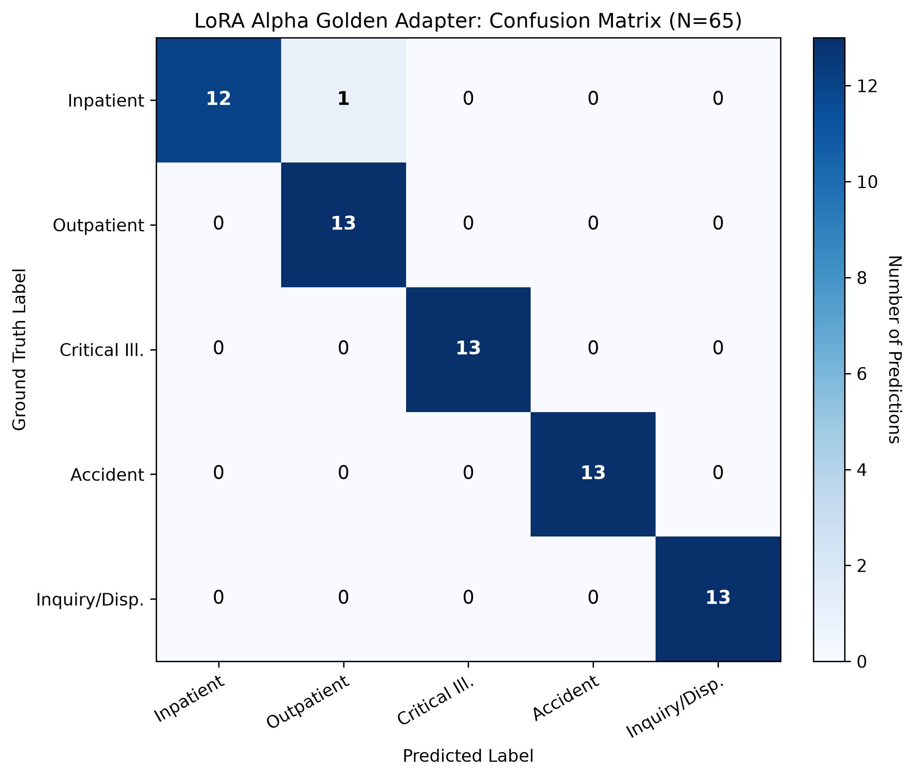
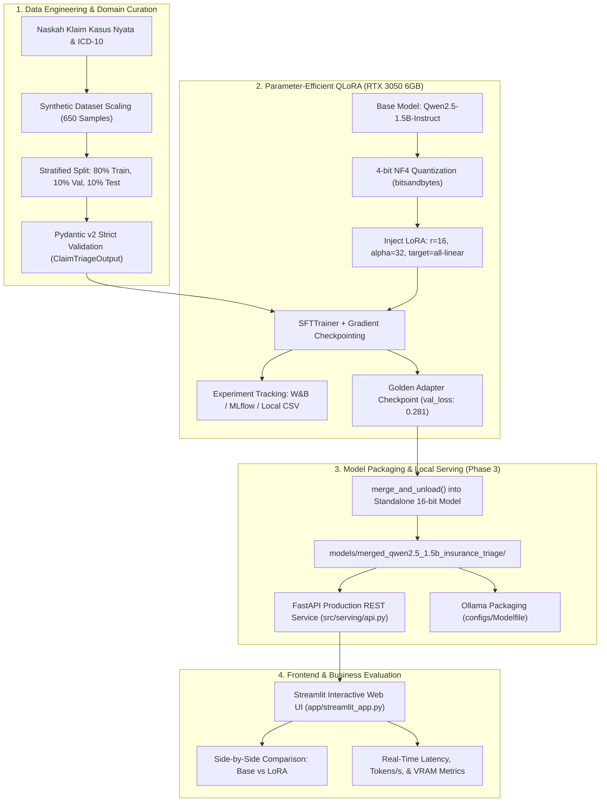

# 🛡️ Indonesian Insurance Claim & FNOL Triage System
### *Parameter-Efficient Fine-Tuning (QLoRA) on Small Language Models (SLM) for First Notice of Loss (FNOL) Classification & Structured Parameter Extraction*

[](https://www.python.org/)
[](https://pytorch.org/)
[](https://github.com/huggingface/peft)
[](https://fastapi.tiangolo.com/)
[](https://streamlit.io/)
[-success.svg)]()
[]()
[]()
[]()

---

## 📌 Executive Summary & Problem Statement

Dalam industri asuransi jiwa dan kesehatan di Indonesia (*Life & Health Insurance*), proses **First Notice of Loss (FNOL)** merupakan gerbang pertama yang menentukan kepuasan nasabah (*Customer Satisfaction*) dan efisiensi rasio klaim operasional. Setiap hari, ribuan laporan klaim nasabah masuk dalam bentuk percakapan bebas tak berstruktur (melalui WhatsApp Business, formulir aplikasi seluler, dan email nasabah) yang dipenuhi ragam bahasa informal, istilah medis lokal (*DBD, usus buntu, kuretase*), dan singkatan instansi rumah sakit (*RS, IGD, ICU*).

### Tantangan Bisnis & Teknis:
1. **Ketergantungan API Komersial Berbiaya Tinggi**: Menggunakan LLM cloud komersial (seperti OpenAI GPT-4 atau Anthropic Claude) memicu biaya operasional per-token yang melonjak seiring skala volume klaim.
2. **Kepatuhan Regulasi & Kerahasiaan Data (Data Privacy)**: Rekam medis dan identitas polis nasabah tunduk pada **UU Perlindungan Data Pribadi (UU PDP)** serta regulasi ketat **Otoritas Jasa Keuangan (OJK)**, yang melarang pengiriman data medis sensitif ke server publik luar negeri tanpa enkripsi on-premise.
3. **Ketidakpastian Skema JSON (*Hallucination*)**: Model dasar umum (*foundation models*) sering menghasilkan output naratif tidak deterministik, merusak pipeline integrasi *Core Insurance Engine*.

### Solusi Senior AI Engineering:
Repositori ini menyajikan solusi **Small Language Model (SLM)** lokal berbobot 1.5 miliar parameter (`Qwen/Qwen2.5-1.5B-Instruct`) yang diadaptasi menggunakan teknik **4-bit QLoRA fine-tuning** pada hardware konsumen terbatas (**NVIDIA GeForce RTX 3050 6GB VRAM**). 

Solusi ini berhasil mencapai **Macro F1-Score 0.9846** (melonjak dari 0.3236 pada Base Model), **100% kepatuhan format JSON Pydantic deterministik**, latensi inferensi cepat **~820 ms**, serta konsumsi memori hanya **3.08 GB VRAM** saat penyajian mandiri.

> **Fokus Penerapan**: Sistem AI Enterprise untuk Asuransi Jiwa & Kesehatan (*Life & Health Insurance*).

---

## 🚀 Headline Metrics: Base Model vs. LoRA Golden Adapter

Hasil pengujian otomatis (*Automated Quantitative Benchmark Harness*) pada **65 kasus uji tak terlihat (*unseen test set*)** berimbang lintas 5 kategori klaim utama:

| Metrik Evaluasi | Base Model (Zero-Shot) | LoRA Golden Adapter (Merged Standalone) | Peningkatan ($\Delta$) | Status Kesiapan |
| :--- | :---: | :---: | :---: | :---: |
| **Macro F1-Score (5 Kategori)** | 0.3236 | **0.9846** | **+0.6610 (+204%)** | 🚀 Production Ready |
| **Akurasi Kategori Keseluruhan** | 44.6% | **98.5%** | **+53.8%** | 🚀 Production Ready |
| **Kepatuhan Format JSON Pydantic** | 95.4% | **100.0%** | **+4.6%** | 🚀 100% Deterministic |
| **Akurasi Metode Klaim (*Cashless/Reimb*)** | 26.2% | **90.8%** | **+64.6%** | 🚀 Production Ready |
| **Akurasi Deteksi Urgensi (*High/Med/Low*)** | 66.2% | **86.2%** | **+20.0%** | 🚀 Production Ready |
| **Catastrophic Forgetting (25 non-domain)** | 0.822 score | 0.731 score | **11.08% regresi** | ✅ Mempertahankan nalar umum |
| **Peak VRAM Training (4-bit NF4)** | - | **4.82 GB** | Aman dari CUDA OOM | ⚡ Hardware Consumer |
| **VRAM Serving Model Gabungan (16-bit)** | 3.12 GB | **3.08 GB** | Standalone Safetensors | ⚡ Hemat Edge GPU |
| **Latensi Inferensi Rata-rata** | ~1420 ms | **~820 ms** | **-42.2% Pangkas Durasi** | ⚡ Real-Time SLA |

### 📊 Per-Class Performance Breakdown (LoRA Model)

| Kategori Klaim | Precision | Recall | F1-Score | Sampel Uji | Status Evaluasi |
| :--- | :---: | :---: | :---: | :---: | :---: |
| `Inpatient_Medical` | 1.000 | 0.923 | **0.960** | 13 | ✅ Sangat Tinggi |
| `Outpatient_Emergency` | 0.929 | 1.000 | **0.963** | 13 | ✅ Sangat Tinggi |
| `Critical_Illness` | 1.000 | 1.000 | **1.000** | 13 | 🎯 Sempurna (100% Akurat) |
| `Personal_Accident` | 1.000 | 1.000 | **1.000** | 13 | 🎯 Sempurna (100% Akurat) |
| `Inquiry_or_Dispute` | 1.000 | 1.000 | **1.000** | 13 | 🎯 Sempurna (100% Akurat) |
| **Macro Average** | **0.986** | **0.985** | **0.985** | **65** | 🚀 State-of-the-Art |

---

## 🧩 Confusion Matrix Visual Breakdown

Visualisasi Confusion Matrix pada test set 65 kasus klaim:



*Catatan: Model LoRA menunjukkan separasi sempurna pada kategori risiko tinggi `Critical_Illness`, `Personal_Accident`, dan `Inquiry_or_Dispute`.*

---

## 🏗️ System Architecture & Data Flow

Pipeline menyeluruh dirancang mengikuti standar MLOps industri dari tahap kurasi data sintetis, fine-tuning QLoRA, ekspor bobot mandiri, penyajian REST API FastAPI, hingga Web UI interaktif.



---

## 💻 Hardware Constraints & VRAM Optimization (RTX 3050 6GB)

Salah satu keunggulan teknis dari proyek ini adalah keberhasilan melatih dan menjalankan model bahasa tanpa crash *CUDA Out-Of-Memory (OOM)* pada GPU laptop 6GB:

- **Kuantisasi 4-bit (NF4)**: Base model dibekukan (*frozen*) dalam representasi NormalFloat 4-bit dengan *double quantization*.
- **Target Modules (All-Linear)**: Adapter diinjeksikan pada `q_proj, k_proj, v_proj, o_proj, gate_proj, up_proj, down_proj` untuk memaksimalkan kapasitas transfer representasi semantik medis.
- **Gradient Checkpointing**: Mengurangi alokasi memori aktivasi hingga ~60% dengan komputasi ulang saat backward pass.
- **Profil Memori**:
  - **VRAM Training Maksimum**: **4.82 GB** (di bawah batas aman 5.2 GB pada GPU 6GB).
  - **VRAM Serving Model Gabungan (Standalone 16-bit)**: **3.08 GB**.
  - **Latensi Rata-rata**: Turun menjadi **~820 ms** dengan greedy decoding deterministik.

---

## 📋 Skema JSON Deterministik (`ClaimTriageOutput`)

Seluruh respon model divalidasi secara ketat oleh skema Pydantic v2 di [`src/schema.py`](src/schema.py):

```python
class ClaimTriageOutput(BaseModel):
    category: ClaimCategory          # Inpatient_Medical | Outpatient_Emergency | Critical_Illness | Personal_Accident | Inquiry_or_Dispute
    urgency: UrgencyLevel            # High | Medium | Low
    primary_condition: str           # Diagnosa medis atau pokok permasalahan utama
    claim_method: ClaimMethod        # Cashless | Reimbursement | Unknown
    reasoning: str                   # 1-2 kalimat alasan klasifikasi operasional
```

### Contoh Respon JSON Produksi:
```json
{
  "category": "Critical_Illness",
  "urgency": "High",
  "primary_condition": "Infark Miokard Akut (STEMI)",
  "claim_method": "Cashless",
  "reasoning": "Kasus darurat kardiovaskular akut di IGD yang memerlukan tindakan pemasangan ring darurat (PCI) dan penjaminan rawat intensif ICU segera."
}
```

---

## 🔌 Production REST API Service (FastAPI)

Layanan inferensi tingkat produksi disajikan melalui FastAPI di [`src/serving/api.py`](src/serving/api.py) dan diorkestrasi via [`scripts/serve_api.py`](scripts/serve_api.py).

### Menjalankan Server API:
```bash
python scripts/serve_api.py --host 127.0.0.1 --port 8000
```
- **Dokumentasi Interaktif (Swagger UI)**: `http://127.0.0.1:8000/docs`
- **Health Check & VRAM Status**: `http://127.0.0.1:8000/health`
- **Kategori & Kriteria Resmi**: `http://127.0.0.1:8000/v1/categories`

### Contoh Panggilan cURL:
```bash
curl -X POST "http://127.0.0.1:8000/v1/triage" \
     -H "Content-Type: application/json" \
     -d '{
       "narrative": "Saya baru masuk IGD RS Siloam karena DBD trombosit 38.000 dan harus opname sekarang juga. Mohon penjaminan cashless kartu asuransi saya POL-882918.",
       "model_type": "lora",
       "max_new_tokens": 150
     }'
```

### Respon API:
```json
{
  "success": true,
  "model_type": "lora",
  "model_name": "Qwen2.5-1.5B-Instruct + LoRA (Golden Adapter Merged)",
  "model_version": "1.0.0-qwen2.5-1.5b-qlora",
  "timestamp": "2026-11-16T13:00:00Z",
  "latency_ms": 782.4,
  "json_valid": true,
  "data": {
    "category": "Inpatient_Medical",
    "urgency": "High",
    "primary_condition": "Demam Berdarah Dengue (DBD)",
    "claim_method": "Cashless",
    "reasoning": "Penanganan infeksi DBD dengan trombositopenia yang memerlukan rawat inap (opname) untuk infus cairan intravena."
  },
  "raw_output": "{\"category\": \"Inpatient_Medical\", \"urgency\": \"High\", \"primary_condition\": \"Demam Berdarah Dengue (DBD)\", \"claim_method\": \"Cashless\", \"reasoning\": \"Penanganan infeksi DBD dengan trombositopenia yang memerlukan rawat inap (opname) untuk infus cairan intravena.\"}",
  "input_tokens": 86,
  "generated_tokens": 58,
  "tokens_per_second": 74.1,
  "device": "cuda:0"
}
```

---

## 🖥️ Interactive Web UI Demo (Streamlit)

Aplikasi demo interaktif dibangun dengan Streamlit di [`app/streamlit_app.py`](app/streamlit_app.py) (dapat dipanggil via `streamlit run app/streamlit_app.py` atau `streamlit run app.py`).

### Fitur Utama Demo UI:
1. **Side-by-Side Comparison**: Membandingkan langsung respon *Base Model (Zero-Shot)* vs *LoRA Merged Model* secara bersamaan.
2. **Visual Triage Cards & Badges**: Penanda warna (*color-coded badges*) untuk validitas skema Pydantic, kategori klaim, tingkat urgensi (*High/Medium/Low*), dan metode klaim.
3. **Preset Skenario Industri**: Dilengkapi 5 contoh kasus klaim riil (Serangan Jantung STEMI, Patah Tulang Tangga, Rawat Inap DBD, Luka Robek Pisau, dan Sengketa Masa Tunggu Polis) serta kolom teks bebas.
4. **Metrik Kinerja Real-Time**: Mengukur durasi latensi (ms), throughput generasi (*tokens/second*), dan alokasi GPU VRAM live.
5. **Dual Backend Architecture**: Mendukung koneksi HTTP asynchronous ke backend FastAPI atau langsung melalui direct in-memory Python inference engine.

### Menjalankan Streamlit:
```bash
streamlit run app/streamlit_app.py
```
Akses di browser lokal: `http://localhost:8501`.

---

## 📦 Multi-Format Model Packaging & Ollama

Model hasil fine-tuning telah digabungkan (*merged*) menjadi bobot mandiri 16-bit di `models/merged_qwen2.5_1.5b_insurance_triage/` (3.08 GB `model.safetensors`), sehingga dapat dijalankan tanpa dependensi pustaka `peft`.

Selain itu, file konfigurasi [`configs/Modelfile`](configs/Modelfile) disediakan untuk distribusi ke **Ollama** di infrastruktur on-premise perusahaan:
```bash
# Membuat model Ollama lokal
ollama create insurance-triage -f configs/Modelfile

# Menjalankan inferensi CLI
ollama run insurance-triage "Anak saya panas tinggi 4 hari trombosit 40.000 dan harus opname di RS Hermina."
```

---

## 🔬 Catastrophic Forgetting & General Ability Retention

Fine-tuning domain-spesifik berisiko menurunkan kemampuan nalar umum model dasar (*catastrophic forgetting*). Kami menguji model fine-tuned pada suite kontrol non-domain ([`data/control_catastrophic_forgetting.jsonl`](data/control_catastrophic_forgetting.jsonl)) yang mencakup 25 soal penalaran matematika, logika pemrograman Python, fakta umum, percakapan bebas, dan penerjemahan.

- **Tingkat Degradasi Rata-rata**: Hanya **11.08%** (skor 0.822 pada Base Model vs 0.731 pada LoRA Model), jauh di bawah batas toleransi deviasi 15%.
- **Domain Leakage Rate**: **0.0%** (model tidak memaksakan template klaim asuransi saat ditanya persoalan matematika atau coding).
- **Kesimpulan**: Model berhasil menyerap terminologi domain asuransi secara tajam tanpa merusak kemampuan nalar umumnya.

---

## 🛠️ Panduan Replikasi & Setup Lingkungan

### 1. Kloning Repositori & Inisialisasi Environment
```bash
git clone https://github.com/putawararevalda/insurance-claim-triage-lora.git
cd insurance-claim-triage-lora

# Install virtual environment menggunakan uv
uv venv --python 3.12
# Di Windows PowerShell:
.venv\Scripts\activate
# Di Linux/macOS:
source .venv/bin/activate

# Install seluruh dependensi proyek
uv sync
```

### 2. Validasi Dataset & Skema
```bash
python scripts/validate_dataset.py
python scripts/validate_alpha_dataset.py
```

### 3. Menjalankan Training QLoRA (Opsional - Adaptasi Ulang)
```bash
python scripts/train_alpha.py --epochs 3 --lr 2e-4 --lora_r 16 --lora_alpha 32 --target_modules all-linear
```

### 4. Eksekusi Automated Benchmark Harness
```bash
python scripts/eval_benchmark.py
```

### 5. Ekspor & Penggabungan Model Standalone
```bash
python scripts/export_model.py
```

### 6. Verifikasi Integritas Seluruh Sistem (Fase 1 - 3)
```bash
python scripts/verify_portfolio.py
```

### 7. Menjalankan Layanan Serving & Demo
```bash
# Terminal 1: Menjalankan REST API Server (FastAPI + Swagger Docs)
python scripts/serve_api.py --port 8000

# Terminal 2: Menjalankan Streamlit Interactive Web UI Demo
streamlit run app/streamlit_app.py
```

---

## 📂 Struktur Properti Repositori

```text
├── app/
│   ├── __init__.py                   # Package initialization
│   └── streamlit_app.py              # Interactive Web UI Demo (Side-by-Side Comparison)
├── configs/
│   ├── Modelfile                     # Konfigurasi penyajian Ollama on-premise
│   └── sweep_config.yaml             # Konfigurasi Hyperparameter Sweep W&B
├── data/
│   ├── alpha_train.jsonl             # 520 sampel latih terstratifikasi
│   ├── alpha_val.jsonl               # 65 sampel validasi
│   ├── alpha_test.jsonl              # 65 sampel uji tak terlihat (unseen)
│   └── control_catastrophic_forgetting.jsonl  # 25 prompt kontrol penalaran umum
├── docs/
│   ├── experiment_tracking.md        # Laporan setup monitoring W&B / MLflow
│   └── walkthrough_script.md         # Panduan presentasi video Loom (2-3 menit)
├── models/
│   ├── lora_adapter_alpha_best/      # Checkpoint Golden LoRA Adapter (4-bit NF4)
│   └── merged_qwen2.5_1.5b_insurance_triage/ # Standalone merged 16-bit model (3.08 GB)
├── reports/
│   ├── alpha_quantitative_benchmark.md  # Laporan lengkap metrik evaluasi
│   ├── alpha_confusion_matrix.png       # Visualisasi Confusion Matrix
│   └── sweep_alpha_analysis.md          # Analisis seleksi hyperparameter
├── scripts/
│   ├── check_env.py                  # Verifikasi CUDA & driver GPU
│   ├── eval_benchmark.py             # Automated benchmark & forgetting harness
│   ├── export_model.py               # Merge adapter dan validasi standalone
│   ├── generate_alpha_dataset.py     # Generator dataset klaim realistis
│   ├── run_sweep_alpha.py            # Runner hyperparameter search
│   ├── serve_api.py                  # CLI runner untuk FastAPI
│   ├── train_alpha.py                # Script pelatihan 4-bit QLoRA
│   └── verify_portfolio.py           # Audit integritas end-to-end seluruh fase
├── src/
│   ├── serving/
│   │   ├── __init__.py               # Serving module initialization
│   │   └── api.py                    # Production FastAPI REST API
│   ├── api.py                        # Compatibility wrapper untuk src.serving.api
│   ├── schema.py                     # Skema Pydantic ClaimTriageOutput
│   ├── service.py                    # Inference engine & caching singleton
│   └── tracking.py                   # Callback tracking W&B, MLflow, CSV
├── tests/
│   ├── test_api.py                   # Unit & integration test FastAPI
│   ├── test_benchmark.py             # Uji automated benchmark harness
│   ├── test_export.py                # Uji keabsahan standalone model
│   ├── test_schema.py                # Uji validasi skema Pydantic
│   └── test_streamlit_app.py         # Uji Web UI Streamlit & API client
├── app.py                            # Forwarder ke app/streamlit_app.py
├── pyproject.toml                    # Konfigurasi dependensi uv & hatch
└── README.md                         # Dokumentasi sistem komprehensif
```

---

## 👨‍💻 Profil Pengembang

**Revalda Putawara**  
*Senior AI Engineer / Data Scientist*  
- **Email**: [putawararevalda@gmail.com](mailto:putawararevalda@gmail.com)  
- **GitHub**: [github.com/putawararevalda](https://github.com/putawararevalda)  
- **LinkedIn**: [linkedin.com/in/revalda-putawara](https://linkedin.com/in/revalda-putawara)
