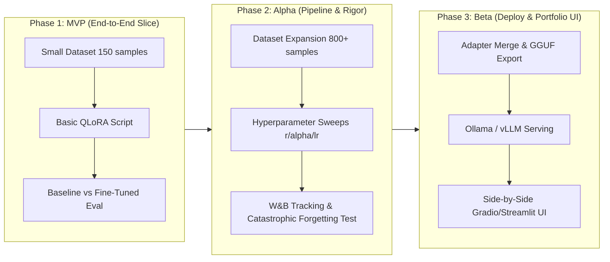

# LoRA Fine-Tuning Portfolio Project: Roadmap & Architecture

## 1. Executive Summary & Objective

This project implements **Project 10: Fine-Tuning Pipeline with LoRA on a Domain-Specific Dataset** as a high-signal AI Engineering portfolio asset. 

The goal is to demonstrate:
1. **Parameter-Efficient Fine-Tuning (PEFT / QLoRA)** on real-world domain constraints.
2. **Hardware-aware engineering** (optimizing for local 6GB VRAM GPU while offering seamless cloud scale-up).
3. **Rigorous MLOps practices** (experiment tracking with W&B/MLflow, reproducible data pipelines, and quantitative eval against catastrophic forgetting).
4. **Production deployment & demo** (GGUF/Ollama serving, FastAPI/vLLM endpoints, and interactive side-by-side evaluation UI).

---

## 2. Hardware Constraints & Base Model Strategy

### Local Environment Hardware Baseline
- **GPU**: NVIDIA GeForce RTX 3050 Laptop GPU (6,144 MiB / 6 GB VRAM)
- **CUDA**: 12.7 (Driver 566.24)
- **Platform**: Windows 11 / WSL2 / uv-managed virtual environment

### Model Selection Architecture
| Model Tier | Candidate Model | Quantization / Method | VRAM Footprint | Target Environment |
| :--- | :--- | :--- | :--- | :--- |
| **Primary (Local SLM)** | **Qwen2.5-1.5B-Instruct** or **Llama-3.2-3B-Instruct** | 4-bit QLoRA (NF4) via Unsloth / PEFT | ~3.8 GB – 5.2 GB | Local Laptop GPU (RTX 3050 6GB) |
| **Secondary (Scale-Up)** | **Llama-3.1-8B-Instruct** or **Mistral-7B-Instruct-v0.3** | 4-bit QLoRA (NF4) | ~10 GB – 12 GB | Cloud GPU (Google Colab T4 / RunPod / Modal) |

> **Strategic Decision**: Develop and validate the end-to-end pipeline locally on **Qwen2.5-1.5B / Llama-3.2-3B** using 4-bit QLoRA. Because the codebase adheres to standard Hugging Face `peft` and `trl` interfaces, scaling up to an 8B model requires only altering the `model_id` in configuration files.

---

## 3. Domain & Task Selection Brainstorming

### Option 1 (Recommended): Indonesian Legal & Regulatory Compliance Assistant
- **Task**: Extract structured compliance requirements, penalties, and legal references (UU / PP / Perpres) from formal regulatory texts into strict JSON, with plain-language Indonesian explanatory summaries.
- **Why It Stands Out**:
  - Leverages existing local domain assets (`indo-law-graph-mcp`, JDIH scraper).
  - High penalty for hallucination in general LLMs; general models frequently invent non-existent article numbers or fail Indonesian legal terminology.
  - Demonstrates multi-lingual fine-tuning and strict schema adherence.
- **Evaluation Metrics**:
  - **JSON Schema Validity**: 100% parseable structured output.
  - **Citation Precision / Exact Match (EM)**: Accurate UU number and article citations.
  - **Domain ROUGE-L & BERTScore**: Indonesian semantic alignment against golden test sets.

### Option 2: Financial Transaction & Expense Entity Extraction
- **Task**: Converting raw, unstructured banking notifications, SMS receipts, and emails into standardized double-entry or categorized expense JSON (merchant, amount, currency, category, date, tax).
- **Why It Stands Out**: Direct synergy with the user's personal finance project portfolio (`ExpenseOwl`, `ExpenseTracker`). Solves real edge-case ambiguities.
- **Evaluation Metrics**: Slot Extraction F1, Numeric Accuracy, Schema Compliance Rate.

### Option 3: DevOps & SRE Incident Log Analysis
- **Task**: Ingesting messy application stack traces and syslogs to classify root-cause categories and generate remediation instructions.
- **Why It Stands Out**: Highly valued in production enterprise environments.
- **Evaluation Metrics**: Root Cause Classification F1, Actionability Score, Latency < 100ms.

> **Recommendation**: **Option 1 (Indonesian Legal / Regulatory Compliance)** as the flagship domain due to domain complexity, unique regional market signal, and existing scraper code.

---

## 4. Staged Project Roadmap



### Phase 1: MVP (Minimal End-to-End Slice)
**Goal**: Validate the complete loop from dataset formatting to local adapter training and zero-shot comparison in under 1 day.
1. **Dataset Creation**:
   - Curate 150–200 high-quality input-output pairs in ChatML format:
     `{"messages": [{"role": "system", ...}, {"role": "user", ...}, {"role": "assistant", ...}]}`.
2. **LoRA Pipeline**:
   - Implement `scripts/train_lora.py` using Hugging Face `peft` + `trl.SFTTrainer` (or `unsloth` for 2x speed / 60% memory reduction).
   - Target linear modules: `q_proj`, `k_proj`, `v_proj`, `o_proj`, `gate_proj`, `up_proj`, `down_proj`.
   - LoRA Config: rank $r=16$, alpha $\alpha=32$, dropout=0.05, 4-bit NormalFloat (NF4).
3. **Verification**:
   - Implement `scripts/eval_quick.py`: Run 10 prompt comparisons showing base model failure/verbosity vs. fine-tuned model precision.

### Phase 2: Alpha (Robust Pipeline, Experiment Tracking & Evaluation)
**Goal**: Transform the quick script into a production-grade, reproducible ML pipeline.
1. **Data Augmentation & Curation**:
   - Expand dataset to 800–1,200 verified pairs with train/val/test splits (80/10/10).
   - Implement automated linting for prompt quality, length distribution, and format consistency.
2. **Systematic Hyperparameter Tuning & Logging**:
   - Integrate **Weights & Biases (W&B)** or **MLflow** for loss curves, GPU memory tracking, and perplexity.
   - Sweep rank $r \in \{8, 16, 32\}$, $\alpha \in \{16, 32, 64\}$, and learning rates ($1\text{e-}4$ to $3\text{e-}4$).
3. **Evaluation Harness**:
   - Automated test suite evaluating JSON syntax validity, Citation Accuracy, and ROUGE-L.
   - **Catastrophic Forgetting Check**: Evaluate on a standard benchmark slice (e.g. MMLU subset or general conversation) to ensure base capabilities remain intact.

### Phase 3: Beta & Portfolio Polish (Production Deployment & Showcase)
**Goal**: Build the interactive deliverables that make hiring managers and stakeholders say "this engineer knows how to ship."
1. **Model Export & Compression**:
   - Merge LoRA adapter weights with base model (`merge_and_unload`).
   - Convert and quantize to GGUF (Q4_K_M, Q5_K_M) via `llama.cpp` for ultra-fast local edge execution.
2. **Serving & API**:
   - Create a `Modelfile` for immediate plug-and-play local serving via **Ollama**.
   - Optional FastAPI / vLLM endpoint for low-latency streaming inference (<100ms first-token latency).
3. **Interactive Portfolio UI**:
   - Build a sleek **Gradio or Streamlit application**:
     - Side-by-side mode: Base Model vs. Fine-Tuned Model on identical inputs.
     - Live metrics display: latency, token speed, hallucination detection highlight.
4. **Portfolio Packaging**:
   - Architectural Mermaid diagrams in README.
   - Clear reproducibility guide (`uv run ...`).
   - Published adapter on Hugging Face Hub (with model card and usage snippet).

---

## 5. Proposed Repository Structure

```
lorafinetuning/
├── .github/workflows/      # Automated code linting & data validation
├── configs/                # Hydra / YAML configs for reproducibility
│   ├── base_lora.yaml
│   └── sweep_config.yaml
├── data/
│   ├── raw/                # Scraped / seed legal texts
│   ├── processed/          # Processed ChatML JSONL splits
│   └── schema/             # Pydantic schemas for structured extraction
├── src/
│   ├── data_pipeline/      # Tokenization, cleaning, formatting
│   ├── training/           # SFTTrainer, LoRA configuration, callbacks
│   ├── evaluation/         # Benchmark suite, forgetting checks
│   └── serving/            # FastAPI / Ollama wrapper
├── app/                    # Gradio / Streamlit side-by-side demo
├── notebooks/              # Exploration & analysis walkthrough
├── ROADMAP.md              # Project roadmap & architecture specification
└── pyproject.toml          # uv / pip dependency specification
```
