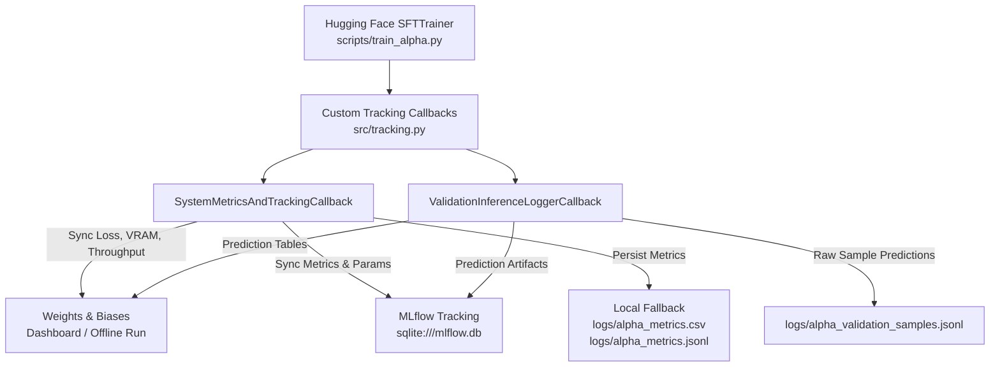

# Panduan Experiment Tracking & Monitoring (W&B / MLflow)

Dokumentasi komprehensif sistem *experiment tracking*, logging metrik sistem, dan monitoring validasi inferensi berkala untuk pipeline fine-tuning 4-bit QLoRA pada **Insurance Claim & FNOL Triage**.

---

## 1. Arsitektur Experiment Tracking

Pipeline training pada `scripts/train_alpha.py` mengintegrasikan sistem pelacakan eksperimen modular melalui modul `src/tracking.py` dengan dukungan **dual-layer tracking**:

1. **Centralized Cloud/Server Trackers**:
   - **Weights & Biases (W&B)**: Visualisasi kurva loss, dashboard hardware GPU, perbandingan run antar eksperimen/hyperparameter sweep, serta pencatatan tabel prediksi sampel validasi (`wandb.Table`).
   - **MLflow Tracking**: Registry parameter, metrik run, dan tabel artefak prediksi lokal menggunakan SQLite backend store (`sqlite:///mlflow.db`).
2. **Local Crash-Resilient Fallback**:
   - Pencatatan otomatis ke `logs/alpha_metrics.csv` dan `logs/alpha_metrics.jsonl` setiap interval logging step.
   - Rekapitulasi checkpoint terbaik dan ringkasan durasi ke `logs/alpha_run_summary.json`.
   - Penyimpanan riwayat inferensi sampel validasi per epoch ke `logs/alpha_validation_samples.jsonl`.
   - **Offline-First Guarantee**: Apabila koneksi internet terputus atau kunci API tidak dikonfigurasi, pipeline otomatis beralih ke mode offline tanpa mengalami crash/kegagalan eksekusi.



---

## 2. Metrik yang Dipantau

Sistem memonitor tiga kelompok metrik utama secara real-time:

### A. Kurva Optimasi & Performa Model
- **`train/loss`**: Cross-entropy training loss per batch logging step.
- **`eval/loss`**: Evaluasi loss pada subset data validasi per epoch / interval step.
- **`eval/perplexity`**: Dihitung secara matematis melalui $\exp(\min(\text{eval\_loss}, 20.0))$ untuk mengukur ketidakpastian model dalam memprediksi token target klaim.
- **`train/learning_rate`**: Jadwal penurunan learning rate (Cosine / Linear annealing dengan warmup).
- **`train/grad_norm`**: Magnitudo norm gradien untuk memantau stabilitas pembaruan bobot adapter LoRA.

### B. Metrik Sistem & Alokasi VRAM GPU (Hardware Constraints)
- **`system/peak_vram_gb`**: Konsumsi memori GPU tertinggi (`torch.cuda.max_memory_allocated()`), dijaga ketat di bawah batas aman **5.0 GB** (kapasitas total NVIDIA RTX 3050 Laptop: 6.0 GB).
- **`system/allocated_vram_gb`**: Alokasi VRAM aktif saat checkpointing/logging.
- **`system/throughput_samples_per_sec`**: Throughput pemrosesan sampel per detik (dihitung dinamis berdasarkan batch size dan durasi step).

### C. Kualitas Inferensi & Kepatuhan Format JSON
- **`Validation Sample Prediction Table`**: Evaluasi berkala terhadap sampel validasi representatif (mencakup kategori *Inpatient*, *Outpatient*, *Critical Illness*, *Personal Accident*, dan *Inquiry/Dispute*).
- Setiap sampel dicatat: prompt input, target output, respons yang digenerasi model, status validasi JSON (`is_valid_json`), serta hasil ekstraksi kategori klaim.

---

## 3. Konfigurasi Weights & Biases (W&B)

### A. Setup Melalui Environment Variable
Buat akun di [wandb.ai](https://wandb.ai), lalu ambil API key dari [wandb.ai/authorize](https://wandb.ai/authorize).

**PowerShell (Windows):**
```powershell
$env:WANDB_API_KEY = "your_wandb_api_key_here"
$env:WANDB_PROJECT = "insurance-claim-triage-lora"
$env:WANDB_MODE = "online"   # Pilihan: 'online' atau 'offline'
```

**Bash / Linux / Git Bash:**
```bash
export WANDB_API_KEY="your_wandb_api_key_here"
export WANDB_PROJECT="insurance-claim-triage-lora"
export WANDB_MODE="online"
```

### B. Setup Melalui CLI Arguments
Anda juga dapat meneruskan konfigurasi langsung saat menjalankan training:
```powershell
uv run python scripts/train_alpha.py `
    --tracker wandb `
    --wandb_project insurance-claim-triage-lora `
    --wandb_mode online `
    --wandb_run_name "alpha-qlora-r16-a32"
```

### C. Mode Offline & Sinkronisasi Susulan (Air-Gapped / Offline Sync)
Jika sedang melatih secara offline tanpa koneksi internet, biarkan script menggunakan mode offline:
```powershell
uv run python scripts/train_alpha.py --tracker wandb --wandb_mode offline
```
Data run tersimpan lokal di direktori `wandb/offline-run-<timestamp>`. Saat koneksi internet kembali tersedia, sinkronisasikan hasil run ke cloud dashboard:
```powershell
uv run wandb sync wandb/offline-run-*
```

---

## 4. Konfigurasi MLflow

Pipeline mendukung penyimpanan eksperimen lokal berbasis database SQLite berkinerja tinggi.

### A. Menjalankan Training dengan MLflow
```powershell
uv run python scripts/train_alpha.py `
    --tracker mlflow `
    --mlflow_experiment insurance-claim-triage-lora `
    --mlflow_tracking_uri "sqlite:///mlflow.db"
```

### B. Menjalankan Dashboard MLflow UI
Untuk melihat grafik visual dan tabel artefak secara lokal:
```powershell
uv run mlflow ui --backend-store-uri "sqlite:///mlflow.db" --port 5000
```
Buka browser pada alamat `http://localhost:5000` untuk membandingkan run, melihat hyperparameter, dan memeriksa metrik.

---

## 5. Menjalankan Training Script

### A. Smoke Test (Verifikasi Cepat Pipeline & Callback)
Digunakan untuk menguji seluruh alur (kuantisasi 4-bit, alokasi VRAM, callback W&B/MLflow, serta ekspor artefak) dalam waktu singkat (~2 menit):
```powershell
uv run python scripts/train_alpha.py --smoke_test --tracker wandb --wandb_mode offline
```

### B. Training Skala Penuh (Phase 2 Alpha Dataset)
Menjalankan training 3 epoch pada 520 contoh training dan 65 contoh validasi:
```powershell
uv run python scripts/train_alpha.py `
    --model_id "Qwen/Qwen2.5-1.5B-Instruct" `
    --train_file "data/alpha_train.jsonl" `
    --val_file "data/alpha_val.jsonl" `
    --output_dir "models/lora_adapter_alpha" `
    --checkpoint_dir "checkpoints/alpha" `
    --epochs 3 `
    --batch_size 2 `
    --grad_accum 4 `
    --lr 2e-4 `
    --lora_r 16 `
    --lora_alpha 32 `
    --tracker wandb `
    --wandb_mode offline
```

---

## 6. Lokasi Artefak & Output

Setelah training selesai, file-file berikut secara otomatis terbuat dan diverifikasi:

| Artefak | Lokasi File | Deskripsi |
|---|---|---|
| **LoRA Adapter Weights** | `models/lora_adapter_alpha/adapter_model.safetensors` | Bobot adapter LoRA terbaik (`load_best_model_at_end=True`). |
| **LoRA Config** | `models/lora_adapter_alpha/adapter_config.json` | Konfigurasi arsitektur adapter PEFT. |
| **Metrics CSV** | `logs/alpha_metrics.csv` | File tabular berisi step, epoch, loss, VRAM, dan throughput. |
| **Metrics JSONL** | `logs/alpha_metrics.jsonl` | Riwayat metrik terstruktur dalam format JSON Lines. |
| **Run Summary** | `logs/alpha_run_summary.json` | Ringkasan durasi, checkpoint terbaik, dan metrik akhir. |
| **Validation Predictions** | `logs/alpha_validation_samples.jsonl` | Riwayat teks inferensi model terhadap sampel validasi uji per epoch. |
